<!--
  Profile README for github.com/BqckF1sh
  Repo must be PUBLIC and named exactly "BqckF1sh".
  Files: assets/header.svg · assets/terminal.svg · assets/footer.svg · .github/workflows/snake.yml
  After the first push: Actions → "snake" → Run workflow (creates the `output` branch).
  Still to do: fill the module table.
-->

<p align="center">
  
</p>

<p align="center">
  
  
  
  
</p>

<p align="center">
  
</p>

### `◢ 01 // active modules`

| module | function | state |
|:--|:--|:--|
| **`TBD`** | — | `▰▰▰▱▱ compiling` |
| **`TBD`** | — | `▰▰▱▱▱ booting` |
| **`TBD`** | — | `▰▱▱▱▱ queued` |

### `◢ 02 // loadout`

<p align="center">
  
</p>

```diff
+ ros2      opencv      numpy / pandas      scikit-learn
- sleep     free_time   weekends_in_october
```

### `◢ 03 // telemetry`

<p align="center">
  
  
</p>

<p align="center">
  
</p>

<p align="center">
  
</p>
